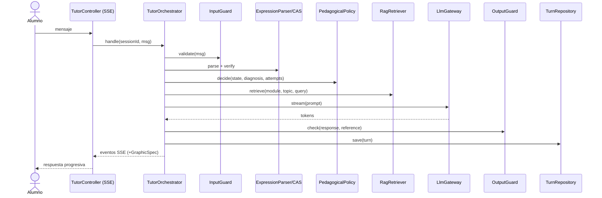

# Arquitectura

Monolito modular Spring Boot 3.x; módulos desacoplados por interfaces: tutorización, motor gráfico, acceso al LLM, persistencia. Cliente web: chat + visor WebGL/GLSL. PostgreSQL + pgvector. Sin microservicios ni arquitectura por eventos.

## Orquestador determinista
Código Java (máquina de estados) fija el nivel de ayuda según estado del ejercicio, diagnóstico CAS e intentos. El LLM se invoca una vez por turno, solo para redactar.

## Flujo de un turno
1. Controles de entrada (longitud, cuota, extracción de solución, inyección)
2. Carga de estado de ejercicio y sesión
3. Interpretación de la expresión (Symja)
4. Verificación CAS y clasificación del error
5. Decisión pedagógica (política determinista)
6. RAG filtrado por módulo y tema
7. Construcción del prompt
8. Llamada al LLM en streaming
9. Control de salida anti-revelación
10. Persistencia y envío al cliente (+ especificación gráfica)

Pasos 1, 3, 4, 5 sin LLM. Ninguna transacción abierta durante la llamada al LLM (RNF-03).

## Módulo gráfico
Backend emite JSON validado por esquema; cliente traduce a geometría y shaders; expresiones validadas con CAS; no se ejecuta código del servidor. Cuatro incrementos: (1) pipeline + 2D, (2) mallado/normales/iluminación/texturas, (3) intersecciones, selección, tangentes, (4) animación + post-procesamiento.

## Seguridad y datos
Sesión por cookie HttpOnly/Secure/SameSite (o tokens cortos), Argon2id/BCrypt, autorización por recurso, RGPD/LOPDGDD/LSSI.
