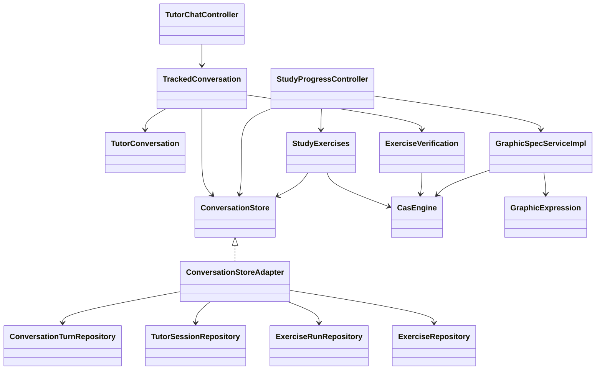
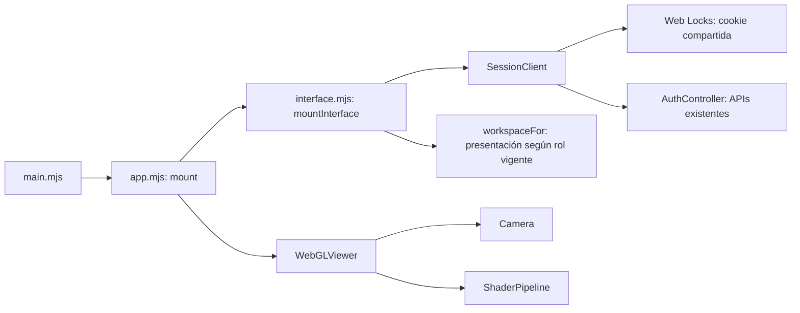
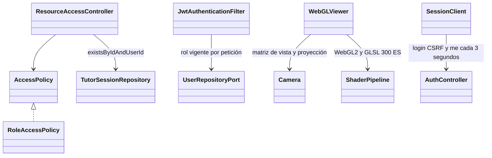
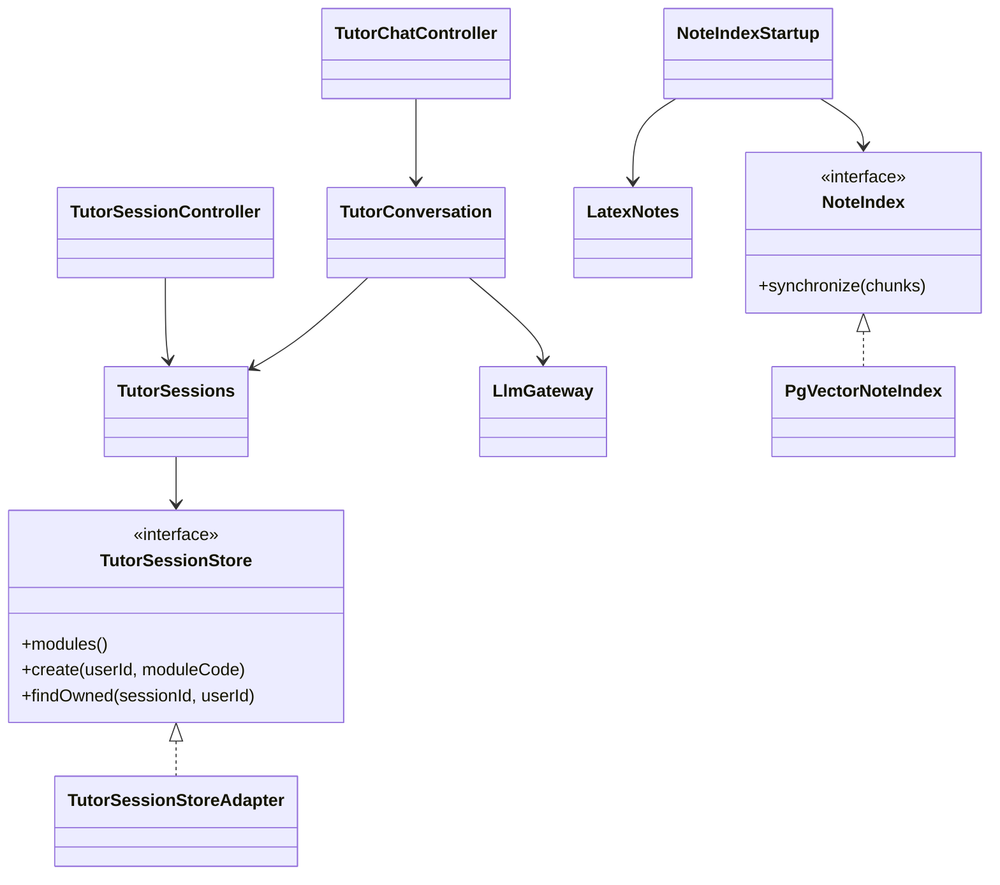

# Diagrama de clases general

## Clases implementadas para Sprint 04

El flujo S4 usa `ConversationStore` para reserva, contexto, registro y progreso propios. Los contratos previos `SessionContextService` e `InteractionLogger` permanecen como diseño futuro; no se atribuye implementación a esos contratos.

`ConversationStoreAdapter` termina las transacciones antes del streaming. `CasEngine.compare` conserva equivalencia, diferencia e indeterminación. La clasificación específica exige evidencia; OTRO evita inventar causas. La interfaz pública de progreso no expone referencias.

## Cliente S2 · Integración frontend

[[Sprint 02 - Frontend]] mantiene `mountInterface → mountTutor.sync` y `mountCurveControls → WebGLViewer`. El tutor controla por separado catálogo cargado, petición en curso e identidad. Una generación invalida resultados tardíos al salir durante una operación; el cambio de identidad limpia también el borrador. Las vistas usan los adaptadores existentes, sin nuevas clases persistentes.

## Cliente del sprint 1 · Ampliación frontend

Vistas y decisiones: [[Sprint 01 - Diseño frontend]]. El módulo gráfico y sus clases de cámara/pipeline se conservan; la interfaz añade navegación y gestión completa de sesión.

`SessionClient` incorpora `register`, `restore`, `logout`, `role` y `post` con CSRF. `mountInterface` coordina rutas, estados ocupados, validación de confirmación y descarte de consultas obsoletas. No se añaden controladores ni contratos backend.

La revisión tras leer S1–S10 incorpora `#/espacio` como destino autenticado de S1 y `workspaceFor(role)` como función de presentación, sin otorgar permisos. Las siete vistas se definen en [[Sprint 01 - Diseño frontend]]; chat, módulos, historial y paneles privilegiados siguen en sus respectivos sprints.

## Diseño general

> [!note] Alcance del diagrama
> El diagrama general incluye diseño futuro. La auditoría [[Auditoria Sprint 01 2026-11-16]] distingue las clases existentes de las previstas; no demuestra implementación de UC-03, UC-27 ni del orquestador.

> Verificar: paquetes, dependencias (solo hacia interfaces), una única llamada a `LlmGateway` por turno, sin transacciones abiertas durante la llamada al LLM.

```mermaid
classDiagram
direction TB

namespace web {
  class AuthController
  class TutorController
  class SessionController
  class ProgressController
  class TeacherStatsController
  class AdminController
  class PrivacyController
  class GraphicController
}

namespace security {
  class SecurityConfig
  class AuthService
  class AccessPolicy
  class PasswordEncoderPort {
    <<interface>>
  }
}

namespace tutor {
  class TutorOrchestrator {
    +handleTurn(sessionId, message) Flux~TurnEvent~
  }
  class InputGuard {
    +validate(message, user) GuardResult
  }
  class QuotaService {
    +check(user) boolean
    +register(user, tokens)
  }
  class PedagogicalPolicy {
    +decide(state, diagnosis, attempts) PedagogicalAction
  }
  class PromptBuilder {
    +build(action, diagnosis, chunks, constraints) Prompt
  }
  class OutputGuard {
    +check(response, reference, chunks) LeakResult
  }
  class SessionContextService {
    +load(sessionId) SessionState
    +update(sessionId, turn)
  }
  class InteractionLogger {
    +record(turn)
  }
  class ExerciseRecognizer {
    +recognize(statement) Optional~Exercise~
  }
  class ProgressionPlanner
}

namespace cas {
  class ExpressionParser {
    <<interface>>
    +parse(text) Expr
  }
  class CasEngine {
    <<interface>>
    +verify(studentExpr, reference) Verification
    +equivalent(a, b) boolean
    +derive(expr, var) Expr
  }
  class SymjaCasEngine
  class LatexExtractor {
    +extract(texFile) List~NoteElement~
  }
  class ErrorClassifier {
    +classify(student, reference) ErrorType
  }
}

namespace knowledge {
  class NoteIndexer {
    +indexAtStartup()
  }
  class RagRetriever {
    <<interface>>
    +retrieve(query, module, topic) List~NoteChunk~
  }
  class PgVectorRetriever
  class ExerciseBankLoader {
    +load() List~Exercise~
  }
}

namespace llm {
  class LlmGateway {
    <<interface>>
    +stream(prompt) Flux~String~
  }
  class SpringAiLlmGateway
  class CircuitBreakerLlmGateway
}

namespace graphics {
  class GraphicSpecService {
    +build(type, function, domain, points) GraphicSpec
  }
  class GraphicSpecValidator {
    +validate(spec) ValidationResult
  }
}

namespace persistence {
  class UserRepository
  class SessionRepository
  class ExerciseRunRepository
  class TurnRepository
  class NoteChunkRepository
  class ExerciseRepository
  class ConsentRepository
  class AuditLogRepository
  class QuotaRepository
}

namespace client {
  class ChatUI
  class WebGLViewer
  class Camera
  class ShaderPipeline
  class MeshBuilder
  class SpecInterpreter
}

TutorController --> TutorOrchestrator
SessionController --> SessionContextService
ProgressController --> ExerciseRunRepository
TeacherStatsController --> ExerciseRunRepository
AdminController --> AuditLogRepository
AdminController --> UserRepository
AuthController --> AuthService
PrivacyController --> ConsentRepository
GraphicController --> GraphicSpecService
AuthService --> PasswordEncoderPort
AuthService --> UserRepository
SecurityConfig --> AccessPolicy

TutorOrchestrator --> InputGuard
TutorOrchestrator --> QuotaService
TutorOrchestrator --> SessionContextService
TutorOrchestrator --> ExpressionParser
TutorOrchestrator --> CasEngine
TutorOrchestrator --> PedagogicalPolicy
TutorOrchestrator --> RagRetriever
TutorOrchestrator --> PromptBuilder
TutorOrchestrator --> LlmGateway
TutorOrchestrator --> OutputGuard
TutorOrchestrator --> InteractionLogger
TutorOrchestrator --> ExerciseRecognizer
TutorOrchestrator --> GraphicSpecService
PedagogicalPolicy --> ProgressionPlanner
ExerciseRecognizer --> CasEngine
ExerciseRecognizer --> ExerciseRepository
OutputGuard --> CasEngine
CasEngine <|.. SymjaCasEngine
SymjaCasEngine --> ErrorClassifier
ExpressionParser <|.. SymjaCasEngine
RagRetriever <|.. PgVectorRetriever
PgVectorRetriever --> NoteChunkRepository
NoteIndexer --> LatexExtractor
NoteIndexer --> NoteChunkRepository
ExerciseBankLoader --> LatexExtractor
ExerciseBankLoader --> ExerciseRepository
LlmGateway <|.. SpringAiLlmGateway
LlmGateway <|.. CircuitBreakerLlmGateway
CircuitBreakerLlmGateway --> SpringAiLlmGateway
GraphicSpecService --> GraphicSpecValidator
GraphicSpecValidator --> CasEngine
InteractionLogger --> TurnRepository
QuotaService --> QuotaRepository
SessionContextService --> SessionRepository

ChatUI --> TutorController : SSE
ChatUI --> WebGLViewer
WebGLViewer --> Camera
WebGLViewer --> ShaderPipeline
WebGLViewer --> MeshBuilder
WebGLViewer --> SpecInterpreter
SpecInterpreter --> GraphicController : JSON
```

## Notas de verificación
- Estado S3: `TutorConversation` invoca `CasEngine.parse` y `RagRetriever.retrieve` antes de `LlmGateway.stream`. La recuperación selecciona primero el tema más relevante del módulo y vuelve a consultar con ambos filtros; la llamada al LLM continúa siendo única.
- UC-22 carga el banco con la migración Flyway `V8__exercise_bank.sql`, que crea temas, ejercicios, pasos canónicos y pistas de errores. `ExerciseBankLoader` permanece como diseño futuro; no es una clase ejecutable en S3.
- UC-29 implementa `surface()` en el cliente como generador de malla y normales; `WebGLViewer.setSurface` y `ShaderPipeline.setSurface` dibujan los triángulos. `MeshBuilder` representa esa responsabilidad, no una clase JavaScript separada.
- UC-04 implementa `mountPrivacy` y `cookieChoice` en el cliente. La preferencia anónima usa una cookie técnica; `PrivacyController` y `ConsentRepository` quedan como diseño previsto para futuros flujos de datos personales.
- Corrección S1 en revisión: el filtro JWT valida exclusivamente tokens de acceso y consulta `UserRepositoryPort` en cada petición para obtener rol y estado actuales (RNF-04). El registro público asigna únicamente ALUMNO.
- La renovación se concentra en una operación transaccional: `TokenServiceAdapter` delega en `RefreshTokenAdapter`, que bloquea primero al usuario con `UserRepository.findByIdForUpdate` y después relee el token con `RefreshTokenRepository.findByTokenHashForUpdate`. La generación del sustituto, la revocación y su almacenamiento son atómicos; el bloqueo por propietario serializa también los cambios de una misma familia.
- `SpringAiGoogleAiStudioChatModel` y `GoogleAiStudioLlmGateway` preservan mensajes de sistema/usuario y consumen SSE; no reintentan ni cambian de proveedor al fallar. `GoogleAiStudioRateLimiter` limita solicitudes locales por configuración y no representa una garantía de cuota Google.
- `SpringAiPgVectorRetriever` rechaza una transacción previa antes de buscar o indexar (`Propagation.NEVER`); la generación de embeddings se realiza sin envolver llamadas remotas en una transacción JDBC. Las consultas usan RETRIEVAL_QUERY y los documentos RETRIEVAL_DOCUMENT.
- El CAS utiliza contextos independientes por operación. La coincidencia en muestras numéricas nunca prueba identidad simbólica; los casos no demostrables conservan estado indeterminado.
- `CircuitBreakerLlmGateway` implementa el modo solo apuntes (UC-26, Sprint 9); antes, `SpringAiLlmGateway` directo.
- `CasEngine` y `ExpressionParser` los implementa Symja; el spike EN-04 decide si se confirma.
- `ExerciseRecognizer` (UC-23, S6) nunca usa LLM ni similitud semántica.
- El cliente no ejecuta código del servidor: `SpecInterpreter` solo mapea el JSON a geometría y shaders.
- Las clases por sprint se pueden filtrar con la columna Sprint de [[Casos de uso]].

## Trazabilidad clase → caso de uso
| Clase / módulo | UC / EN |
|---|---|
| AuthController, AuthService, SecurityConfig | UC-01, UC-03, EN-02 |
| PrivacyController, ConsentRepository | UC-04, UC-05, EN-09 |
| SessionController, SessionContextService | UC-12, UC-20 |
| TutorController, TutorOrchestrator | UC-13 |
| NoteIndexer, LatexExtractor | UC-14 |
| RagRetriever, PgVectorRetriever | UC-15 |
| ExpressionParser | UC-16 |
| CasEngine, ErrorClassifier | UC-17 |
| PedagogicalPolicy, PromptBuilder | UC-18 |
| OutputGuard | UC-19 |
| InputGuard, QuotaService | UC-21 |
| ExerciseBankLoader | UC-22 |
| ExerciseRecognizer | UC-23 |
| ProgressionPlanner | UC-24 |
| InteractionLogger | UC-25 |
| CircuitBreakerLlmGateway | UC-26 |
| WebGLViewer, Camera, ShaderPipeline | UC-27 |
| MeshBuilder | UC-28, UC-29 |
| GraphicSpecService, GraphicSpecValidator, SpecInterpreter | UC-35, UC-31 |
| ProgressController | UC-11 |
| TeacherStatsController | UC-10 |
| AdminController | UC-06, UC-07, UC-08, UC-09 |

## Cierre técnico S1 · UC-03 y UC-27 (2026-11-16)

- `GET /api/access/sessions/{id}` devuelve 204 si el rol puede leer sesiones y el usuario es propietario; 403 si es ajena, inexistente o el rol no tiene acceso; 401 sin identidad activa. No revela datos ni existencia de recursos ajenos.
- Alumno: lectura de contenido y sesiones propias. Profesor: contenido y estadísticas agregadas. Administrador: permisos de gestión; el acceso individual ajeno se reserva a UC-09 y su auditoría. Ninguna ruta administrativa de otros sprints se implementa aquí.
- El cliente `/visor/index.html` incluye ejes de referencia, controles de órbita, zoom y desplazamiento por ratón/teclado, recuperación del contexto y errores en español. El pipeline usa shaders propios; dibuja bajo demanda, libera GPU al salir y conserva funcionamiento al volver desde la caché de navegación.
- El rol visible se consulta cada 3 s con timeout de 2 s y rechazo de respuestas obsoletas; el token se conserva únicamente en memoria. Pruebas Node con cobertura V8 y smoke Chromium que compila shaders y comprueba píxeles reales.
- Las gráficas, superficies, iluminación, selección e interpretación de especificaciones siguen perteneciendo a sus sprints. Véase [[Sprint 01]].

## Incremento implementado en Sprint 02

El catálogo y las sesiones de UC-12 se exponen mediante `TutorSessionController`, `TutorSessions` y el puerto `TutorSessionStore`. `TutorSessionStoreAdapter` termina su transacción antes de devolver una instantánea. Cada selección crea una sesión nueva; no existe endpoint para cambiar el módulo de una sesión. La propiedad se comprueba antes de invocar el LLM. Los endpoints del alumno requieren el rol ALUMNO y CSRF en POST.

`TutorChatController` entrega un POST SSE con eventos JSON TOKEN/DONE/ERROR. `TutorConversation` llama una sola vez al gateway por suscripción y no reintenta ni mantiene transacciones. Se desactiva Open EntityManager in View en todos los perfiles. El cliente conserva solo el historial visible en memoria: el contexto conversacional persistente corresponde a UC-20, no a este incremento.

`PgVectorNoteIndex` utiliza el overload de documentos de Spring AI para generar embeddings de documentos, fuera de cualquier transacción. Después sustituye atómicamente solo las filas etiquetadas `managed_by=UC-14` en la tabla estándar `vector_store`. La búsqueda de UC-15 podrá consumir esos metadatos sin otra copia del índice. En el cliente, `expression/curve` calculan geometría y aproximaciones; `ShaderPipeline.setGraph` dibuja segmentos y trapecios triangulados, y `Camera` adapta la proyección ortográfica para 2D.

### Importación del corpus Industriales

El flujo de UC-14 añade un importador offline (`scripts/import_industriales.py`) y un manifiesto de procedencia. El runtime conserva `NoteIndexStartup → LatexNotes → NoteIndex`: no lee el directorio externo del usuario ni ejecuta los fuentes. Se indexan ocho recursos de tema, con 121 fragmentos; los doce archivos fuente de referencia quedan excluidos por el glob no recursivo. La CI comprueba que los derivados se regeneran exactamente.
