# Diagrama de clases general

> Verificar: paquetes, dependencias (solo hacia interfaces), una única llamada a `LlmGateway` por turno, sin transacciones abiertas durante la llamada al LLM.

```mermaid
classDiagram
direction TB

namespace web {
  class AuthController
  class TutorController
  class SessionController
  class ProgressController
  class TeacherStatsController
  class AdminController
  class PrivacyController
  class GraphicController
}

namespace security {
  class SecurityConfig
  class AuthService
  class AccessPolicy
  class PasswordEncoderPort {
    <<interface>>
  }
}

namespace tutor {
  class TutorOrchestrator {
    +handleTurn(sessionId, message) Flux~TurnEvent~
  }
  class InputGuard {
    +validate(message, user) GuardResult
  }
  class QuotaService {
    +check(user) boolean
    +register(user, tokens)
  }
  class PedagogicalPolicy {
    +decide(state, diagnosis, attempts) PedagogicalAction
  }
  class PromptBuilder {
    +build(action, diagnosis, chunks, constraints) Prompt
  }
  class OutputGuard {
    +check(response, reference, chunks) LeakResult
  }
  class SessionContextService {
    +load(sessionId) SessionState
    +update(sessionId, turn)
  }
  class InteractionLogger {
    +record(turn)
  }
  class ExerciseRecognizer {
    +recognize(statement) Optional~Exercise~
  }
  class ProgressionPlanner
}

namespace cas {
  class ExpressionParser {
    <<interface>>
    +parse(text) Expr
  }
  class CasEngine {
    <<interface>>
    +verify(studentExpr, reference) Verification
    +equivalent(a, b) boolean
    +derive(expr, var) Expr
  }
  class SymjaCasEngine
  class LatexExtractor {
    +extract(texFile) List~NoteElement~
  }
  class ErrorClassifier {
    +classify(student, reference) ErrorType
  }
}

namespace knowledge {
  class NoteIndexer {
    +indexAtStartup()
  }
  class RagRetriever {
    <<interface>>
    +retrieve(query, module, topic) List~NoteChunk~
  }
  class PgVectorRetriever
  class ExerciseBankLoader {
    +load() List~Exercise~
  }
}

namespace llm {
  class LlmGateway {
    <<interface>>
    +stream(prompt) Flux~String~
  }
  class SpringAiLlmGateway
  class CircuitBreakerLlmGateway
}

namespace graphics {
  class GraphicSpecService {
    +build(type, function, domain, points) GraphicSpec
  }
  class GraphicSpecValidator {
    +validate(spec) ValidationResult
  }
}

namespace persistence {
  class UserRepository
  class SessionRepository
  class ExerciseRunRepository
  class TurnRepository
  class NoteChunkRepository
  class ExerciseRepository
  class ConsentRepository
  class AuditLogRepository
  class QuotaRepository
}

namespace client {
  class ChatUI
  class WebGLViewer
  class Camera
  class ShaderPipeline
  class MeshBuilder
  class SpecInterpreter
}

TutorController --> TutorOrchestrator
SessionController --> SessionContextService
ProgressController --> ExerciseRunRepository
TeacherStatsController --> ExerciseRunRepository
AdminController --> AuditLogRepository
AdminController --> UserRepository
AuthController --> AuthService
PrivacyController --> ConsentRepository
GraphicController --> GraphicSpecService
AuthService --> PasswordEncoderPort
AuthService --> UserRepository
SecurityConfig --> AccessPolicy

TutorOrchestrator --> InputGuard
TutorOrchestrator --> QuotaService
TutorOrchestrator --> SessionContextService
TutorOrchestrator --> ExpressionParser
TutorOrchestrator --> CasEngine
TutorOrchestrator --> PedagogicalPolicy
TutorOrchestrator --> RagRetriever
TutorOrchestrator --> PromptBuilder
TutorOrchestrator --> LlmGateway
TutorOrchestrator --> OutputGuard
TutorOrchestrator --> InteractionLogger
TutorOrchestrator --> ExerciseRecognizer
TutorOrchestrator --> GraphicSpecService
PedagogicalPolicy --> ProgressionPlanner
ExerciseRecognizer --> CasEngine
ExerciseRecognizer --> ExerciseRepository
OutputGuard --> CasEngine
CasEngine <|.. SymjaCasEngine
SymjaCasEngine --> ErrorClassifier
ExpressionParser <|.. SymjaCasEngine
RagRetriever <|.. PgVectorRetriever
PgVectorRetriever --> NoteChunkRepository
NoteIndexer --> LatexExtractor
NoteIndexer --> NoteChunkRepository
ExerciseBankLoader --> LatexExtractor
ExerciseBankLoader --> ExerciseRepository
LlmGateway <|.. SpringAiLlmGateway
LlmGateway <|.. CircuitBreakerLlmGateway
CircuitBreakerLlmGateway --> SpringAiLlmGateway
GraphicSpecService --> GraphicSpecValidator
GraphicSpecValidator --> CasEngine
InteractionLogger --> TurnRepository
QuotaService --> QuotaRepository
SessionContextService --> SessionRepository

ChatUI --> TutorController : SSE
ChatUI --> WebGLViewer
WebGLViewer --> Camera
WebGLViewer --> ShaderPipeline
WebGLViewer --> MeshBuilder
WebGLViewer --> SpecInterpreter
SpecInterpreter --> GraphicController : JSON
```

## Notas de verificación
- `CircuitBreakerLlmGateway` implementa el modo solo apuntes (UC-26, Sprint 9); antes, `SpringAiLlmGateway` directo.
- `CasEngine` y `ExpressionParser` los implementa Symja; el spike EN-04 decide si se confirma.
- `ExerciseRecognizer` (UC-23, S6) nunca usa LLM ni similitud semántica.
- El cliente no ejecuta código del servidor: `SpecInterpreter` solo mapea el JSON a geometría y shaders.
- Las clases por sprint se pueden filtrar con la columna Sprint de [[Casos de uso]].

## Trazabilidad clase → caso de uso
| Clase / módulo | UC / EN |
|---|---|
| AuthController, AuthService, SecurityConfig | UC-01, UC-03, EN-02 |
| PrivacyController, ConsentRepository | UC-04, UC-05, EN-09 |
| SessionController, SessionContextService | UC-12, UC-20 |
| TutorController, TutorOrchestrator | UC-13 |
| NoteIndexer, LatexExtractor | UC-14 |
| RagRetriever, PgVectorRetriever | UC-15 |
| ExpressionParser | UC-16 |
| CasEngine, ErrorClassifier | UC-17 |
| PedagogicalPolicy, PromptBuilder | UC-18 |
| OutputGuard | UC-19 |
| InputGuard, QuotaService | UC-21 |
| ExerciseBankLoader | UC-22 |
| ExerciseRecognizer | UC-23 |
| ProgressionPlanner | UC-24 |
| InteractionLogger | UC-25 |
| CircuitBreakerLlmGateway | UC-26 |
| WebGLViewer, Camera, ShaderPipeline | UC-27 |
| MeshBuilder | UC-28, UC-29 |
| GraphicSpecService, GraphicSpecValidator, SpecInterpreter | UC-35, UC-31 |
| ProgressController | UC-11 |
| TeacherStatsController | UC-10 |
| AdminController | UC-06, UC-07, UC-08, UC-09 |
