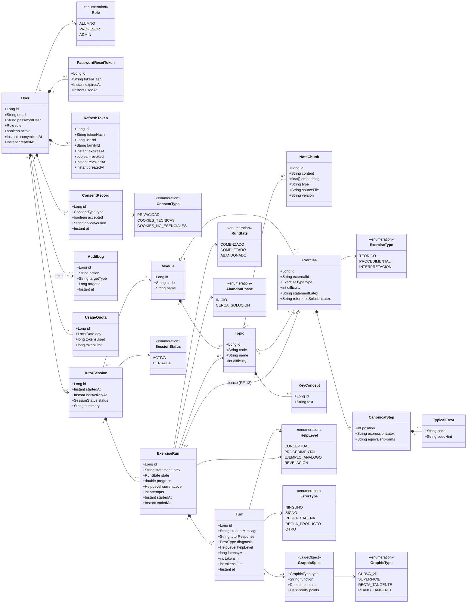

# Diagrama de dominio

> Verificar: entidades, atributos, relaciones y multiplicidades antes de generar entidades JPA.

## Notas de verificación
- Auditoría S1: el diseño general incluye entidades de casos de uso futuros y no acredita que estén implementados; véase [[Auditoria Sprint 01 2026-11-16]].
- La sesión implementada incorpora `RefreshToken`: hash SHA-256 del token de alta entropía, usuario, familia, expiración y revocación. El hash es consultable por índice y la rotación bloquea el token anterior antes de emitir el siguiente. Las contraseñas conservan Argon2id.
- Migrar desde hashes Argon2id de refresh tokens obliga a iniciar sesión de nuevo; no cambia el hash de las contraseñas.
- Los roles del dominio son ALUMNO, PROFESOR y ADMIN. El alta pública no concede roles privilegiados; permisos y estado activo se obtienen del usuario persistido al autenticar cada petición.
- Los apuntes y el banco se cargan desde el código fuente (no hay carga por profesorado); `NoteChunk` y `Exercise` son de solo lectura en ejecución.
- `Exercise.externalId` es estable entre versiones (lo referencian registros y estadísticas).
- Un turno puede existir sin `ExerciseRun` de banco (ejercicio libre): `ExerciseRun.exercise` es opcional.
- Estadística docente (RF-24) se calcula agregando `ExerciseRun` por módulo y tema, sin exponer `User`.
- `GraphicSpec` no se persiste como entidad propia salvo necesidad (valor embebido en `Turn`).

## Control de propiedad S1 · 2026-11-16

- UC-03 utiliza la relación existente `User` → `TutorSession`; no incorpora entidades nuevas. La consulta de autorización combina id de sesión e id del usuario autenticado en la base de datos.
- El rol incluido en el JWT no decide los permisos: se consulta el usuario activo persistido en cada petición. Cambios de rol y desactivaciones se aplican sin renovar el token.
- El registro público solo admite ALUMNO; no permite elegir PROFESOR ni ADMIN. La provisión de roles privilegiados y los flujos administrativos continúan fuera del alcance de S1.
- UC-27 añade clases del cliente (`WebGLViewer`, `Camera`, `ShaderPipeline`, `SessionClient`), sin cambios en el modelo persistente. Véase [[Diagrama de clases]].
