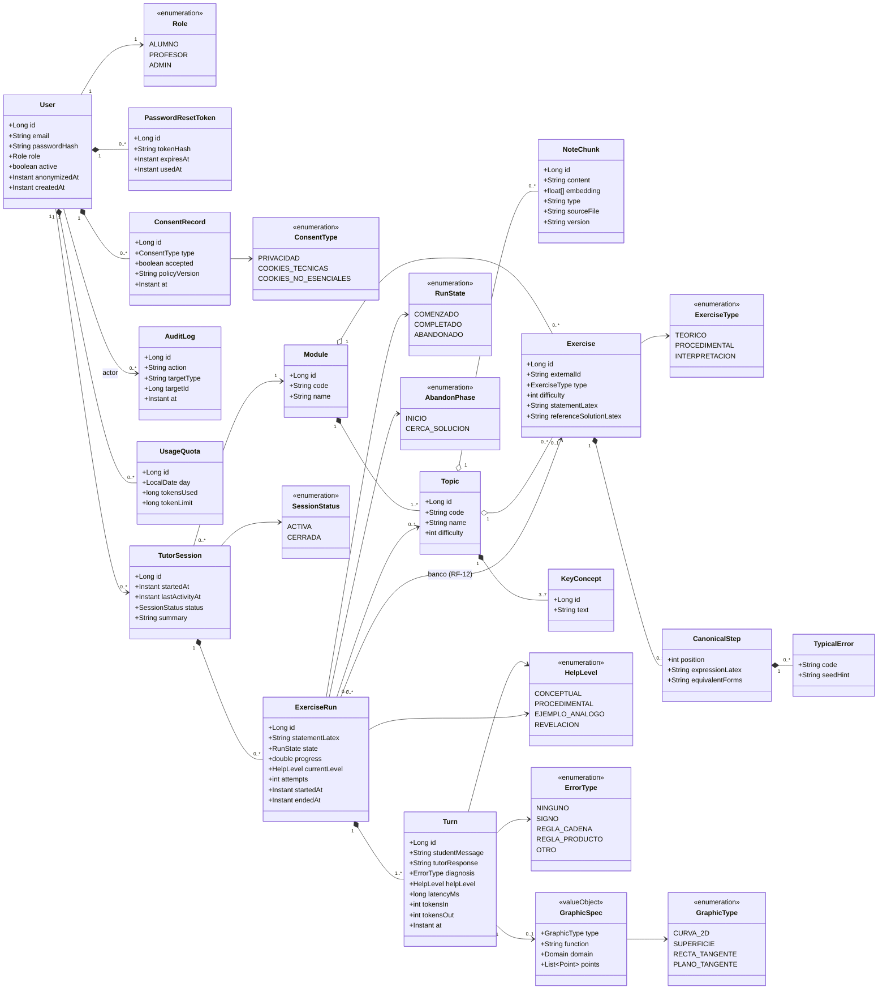

# Diagrama de dominio

> Verificar: entidades, atributos, relaciones y multiplicidades antes de generar entidades JPA.

## Notas de verificación
- Los apuntes y el banco se cargan desde el código fuente (no hay carga por profesorado); `NoteChunk` y `Exercise` son de solo lectura en ejecución.
- `Exercise.externalId` es estable entre versiones (lo referencian registros y estadísticas).
- Un turno puede existir sin `ExerciseRun` de banco (ejercicio libre): `ExerciseRun.exercise` es opcional.
- Estadística docente (RF-24) se calcula agregando `ExerciseRun` por módulo y tema, sin exponer `User`.
- `GraphicSpec` no se persiste como entidad propia salvo necesidad (valor embebido en `Turn`).
